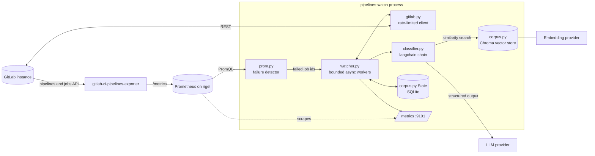
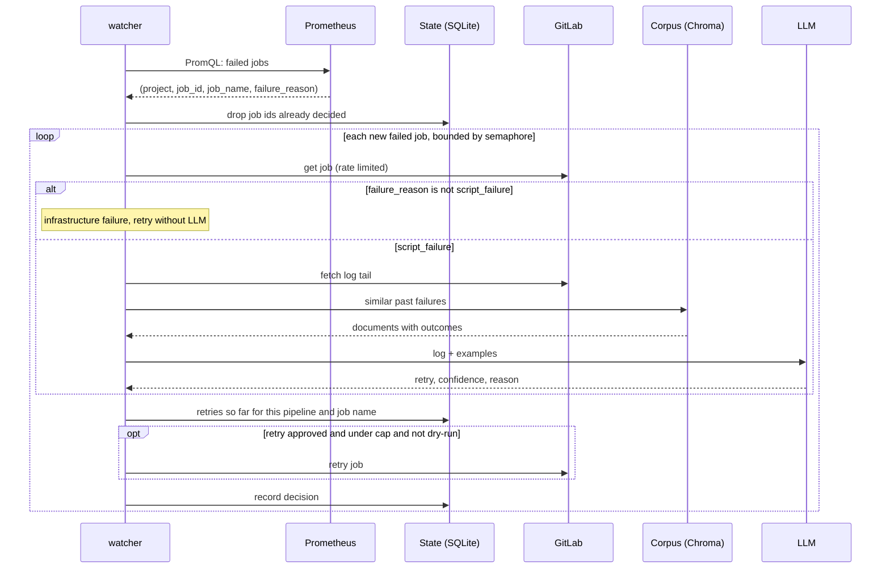
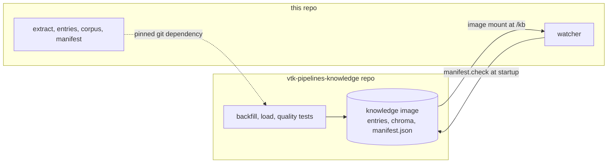
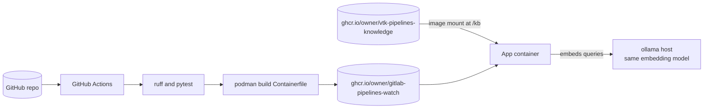
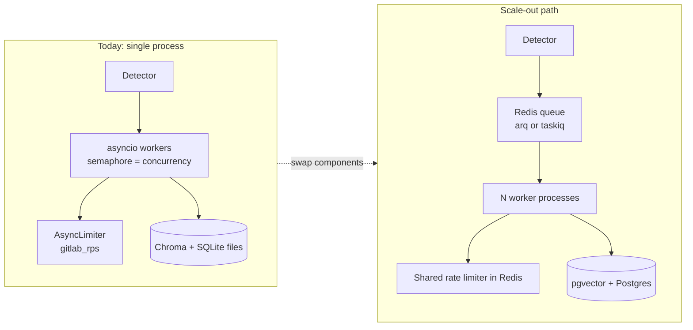

# Architecture

pipelines-watch detects failed GitLab CI jobs through Prometheus and retries the
ones an LLM judges transient, using a corpus of past failures (with their
observed outcomes) as retrieval context.

It is the online half of a two-repo project (the offline half, which builds the
corpus, is `vtk-pipelines-knowledge`). It consolidates two earlier pieces of work:

- `gitlab-pipelines-babysitter`: retry logic and a zero-shot LLM prompt.
- `rigel-deploy`: the Prometheus server (on `rigel`) that scrapes GitLab.

## Design principles

- Use libraries, write little: `python-gitlab`, `prometheus-api-client`,
  `langchain`, `langchain-chroma`, `aiolimiter`, `pydantic-settings`,
  `prometheus_client`.
- Protect the GitLab instance: one shared rate limiter for every API call,
  bounded concurrency, a retry cap per job, and deduplication of decisions.
- Scale by swapping components behind library interfaces, not by rewriting.

## Components

The exporter is required because GitLab's own `/-/metrics` endpoint exposes
instance internals (Puma, Sidekiq), not per-job status. The exporter's
`gitlab_ci_pipeline_job_id` metric carries the job id as its value and a
`failure_reason` label, which is all the detector needs. Job metrics must be
enabled with `project_defaults.pull.pipeline.jobs.enabled`.

## Decision flow for one poll cycle

A job is retried only when the decision is `retry`, confidence is at least
`min_confidence`, and the retry count for its (pipeline, job name) is below
`max_retries_per_job`.

## The corpus is built elsewhere

Corpus building (backfill from GitLab history, LLM extraction into markdown
entries, embedding into Chroma, retrieval-quality tests) lives in the separate
repo `vtk-pipelines-knowledge`, because its lifecycle is different: it is
offline, experimental, token-hungry, and its output is data. See its
`ARCHITECTURE.md` for the stages. This repo only reads the result.

The watcher uses these library modules, which that repo also imports so both
sides agree on the format:

| Module | Used by the watcher to | Used by the builder to |
|---|---|---|
| `extract.py` | turn a new failure into a snippet, platform and error type | do the same for historical failures |
| `entries.py` | (not needed at runtime) | write and parse entry markdown files |
| `corpus.py` | search the Chroma database | create and fill it |
| `manifest.py` | refuse an incompatible corpus at startup | stamp the corpus it built |

### The contract

`manifest.json` in the knowledge image records the embedding model and the
`EXTRACTION_VERSION` the corpus was built with. At startup the watcher compares
them with its own configuration and refuses to run on a mismatch, because
retrieval would silently degrade: vectors from two embedding models cannot be
compared, and a changed extraction prompt makes new failures look different
from the stored ones.

Release flow when extraction changes: edit the code here, bump
`EXTRACTION_VERSION`, tag a release; in the knowledge repo, bump the pinned
version, rebuild, publish; then deploy the new app image together with the new
knowledge image.

## Delivery

The corpus ships in its own image, built by the knowledge repo, so it can be
refreshed without rebuilding the app. The app image never contains the corpus.

## Scaling model

| Concern | Today | Scale-out change |
|---|---|---|
| Work distribution | `asyncio` tasks bounded by `concurrency` | Detector enqueues one task per job; workers pull from Redis |
| GitLab protection | In-process `AsyncLimiter` (`gitlab_rps`) | Same limit, shared across workers via Redis |
| Vector store | Chroma, persisted to `knowledge/chroma` | Another langchain `VectorStore` (pgvector); only `Corpus.__init__` changes |
| State | SQLite `data/state.db` (`PW_STATE_DIR`) | Postgres, same schema |
| Duplicate work | `decisions` primary key (project, job_id) | Same key, enforced by the shared database |

The detector is stateless: it only reads Prometheus and the `decisions` table,
so several detectors can run safely once state is shared.

## Configuration

All settings are `PW_*` environment variables, defined in `config.py`:

| Variable | Default | Purpose |
|---|---|---|
| `PW_GITLAB_URL` | `https://gitlab.kitware.com` | GitLab instance |
| `PW_GITLAB_TOKEN` | required | Token with `api` scope |
| `PW_PROMETHEUS_URL` | `http://rigel:9090` | Prometheus server |
| `PW_LLM_MODEL` | `anthropic:claude-sonnet-5-5` | Classifier, `provider:model` for `init_chat_model` |
| `PW_EXTRACT_MODEL` | `anthropic:claude-haiku-5-5` | Snippet and platform extraction |
| `PW_EMBEDDING_MODEL` | `ollama:nomic-embed-text` | `provider:model` for `init_embeddings` |
| `PW_KNOWLEDGE_DIR` | `knowledge` | Where the corpus (from the knowledge image) is mounted |
| `PW_STATE_DIR` | `data` | Watcher decision log (SQLite), never shipped |
| `PW_CONCURRENCY` | 8 | In-flight jobs |
| `PW_GITLAB_RPS` | 5 | GitLab requests per second |
| `PW_MAX_RETRIES_PER_JOB` | 2 | Per (pipeline, job name) |
| `PW_MIN_CONFIDENCE` | 0.6 | Threshold to act on an LLM retry decision |
| `PW_DRY_RUN` | false | Log decisions without retrying |

## Module map

| File | Responsibility |
|---|---|
| `config.py` | Settings |
| `prom.py` | PromQL query for failed jobs |
| `gitlab.py` | Async, rate-limited wrapper over `python-gitlab` |
| `classifier.py` | langchain prompt and structured `Decision` output |
| `corpus.py` | `Corpus` (vector store, read-only for the watcher) and `State` (SQLite decisions) |
| `watcher.py` | Poll loop and per-job decision flow |
| `entries.py` | `Entry` model and its markdown files |
| `extract.py` | LLM extraction of snippet, platform and error type; scrubbing |
| `manifest.py` | Writes (builder) and checks (watcher) the corpus manifest |
| `cli.py` | The `watch` command |

## Observability

The process exposes its own metrics on `PW_METRICS_PORT` through
`prometheus_client` (jobs seen, decisions by outcome, retries issued, LLM
latency), and `rigel-deploy` should add it as a scrape target so Prometheus
watches the watcher.

## Known limits

- The exporter reports job state at its own pull interval, so detection lags
  failures by up to that interval.
- Single process does not survive host loss mid-cycle; decisions are recorded
  after the action, so a crash between retry and record can retry a job once
  more, bounded by `max_retries_per_job`.
